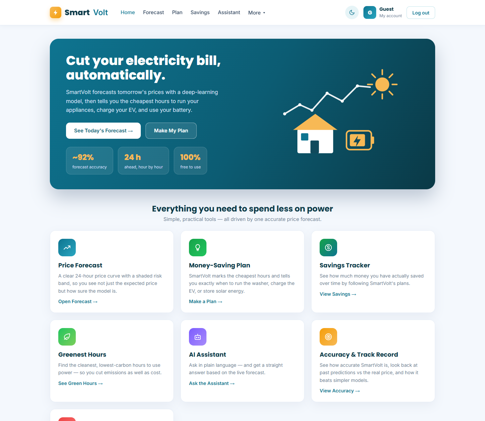
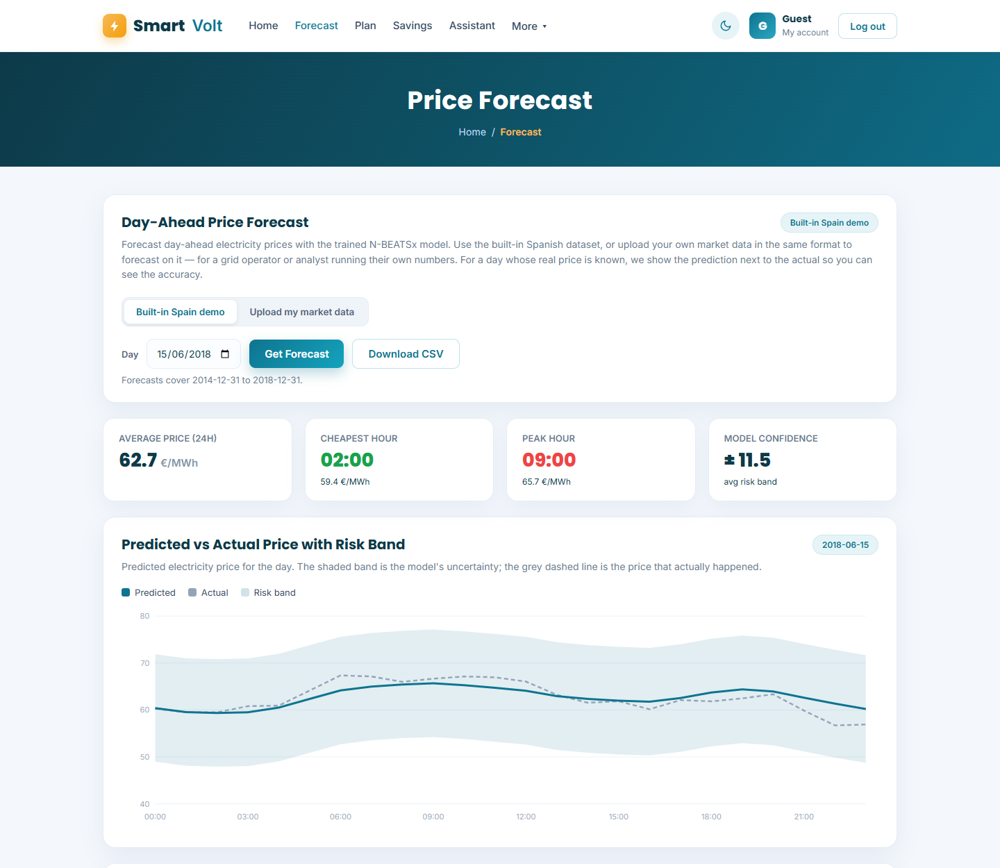
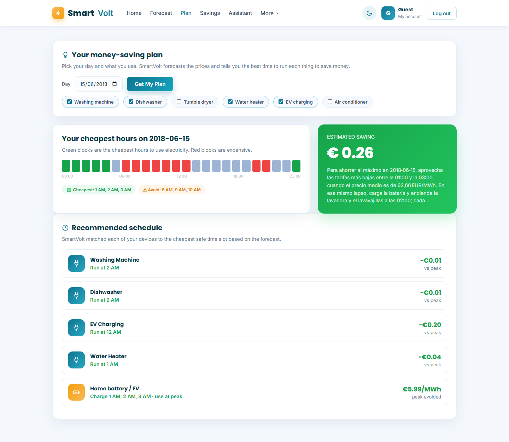
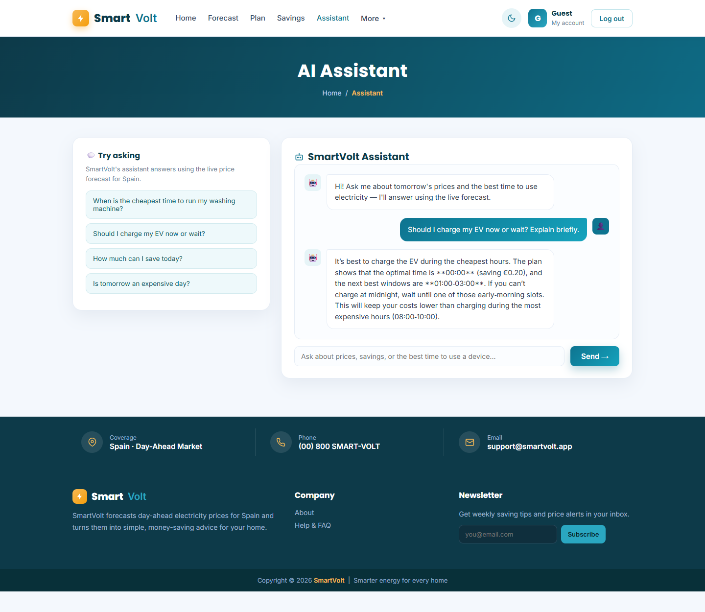
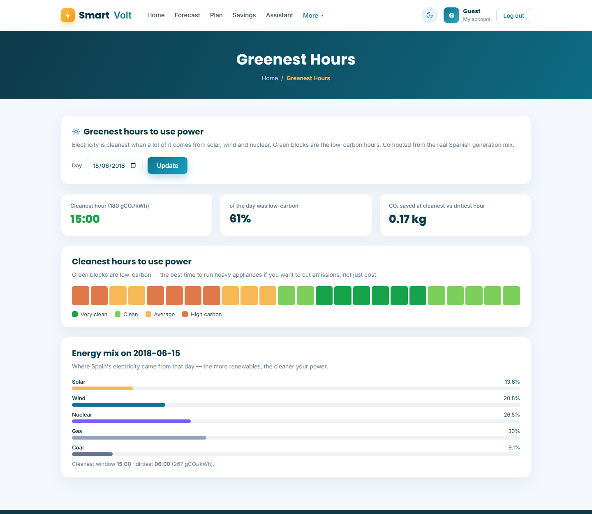
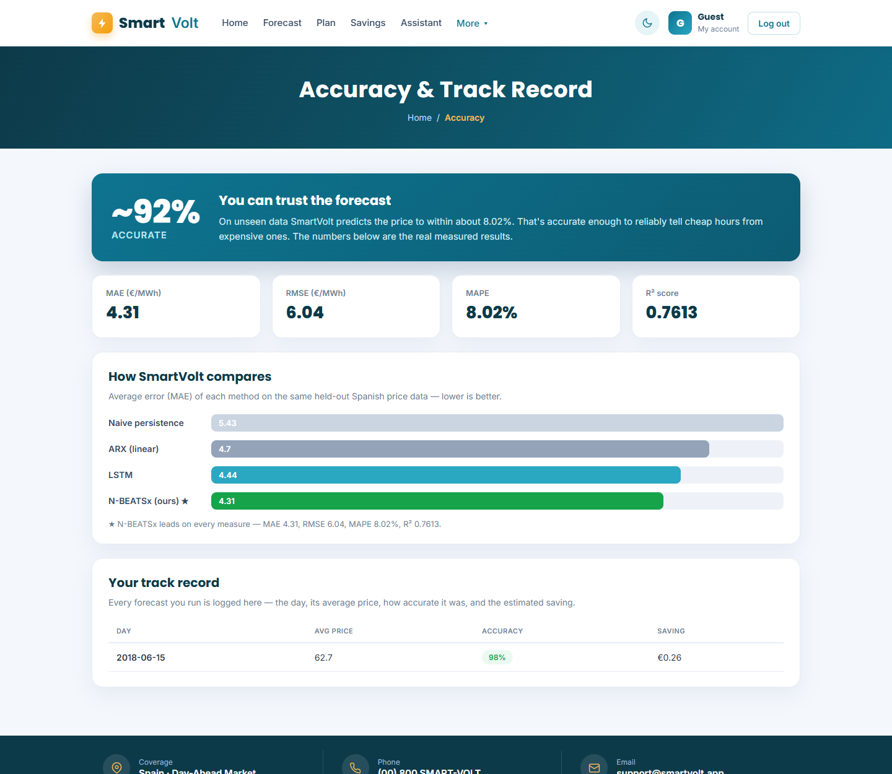
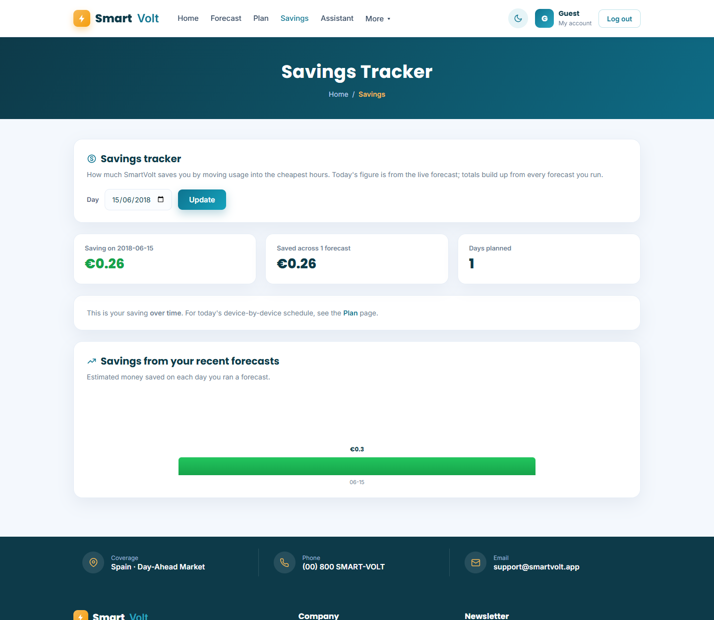

# Electricity Price Forecasting using Deep Learning — SmartVolt

Final Year Project, University of Management and Technology, Lahore.

SmartVolt forecasts day-ahead electricity prices for the Spanish market with an
N-BEATSx deep-learning model, attaches a calibrated risk band to each forecast, and
uses a team of AI agents (built with the Agno framework and a Groq LLM) to turn the
forecast into plain-language, money-saving advice: the cheapest hours to run
appliances, charge an EV and use a home battery.

## Features
- **Day-ahead forecast** — 24-hour predicted vs actual price with a Monte Carlo Dropout 95% risk band
- **Money-saving plan** — best times to run each appliance, plus add-your-own-device
- **Battery / solar advice** — hour-by-hour charge/discharge and BUY / SELL / HOLD signals
- **Greenest hours** — carbon intensity and energy mix for each hour
- **Forecast on your own data** — upload your own market CSVs; the app validates, cleans and forecasts on them
- **Multi-agent AI assistant** — Forecast Analyst + Energy Strategy Advisor, with a chat
- **Accuracy** — model vs baseline metrics
- **History, user accounts, settings and dark mode**

## Screenshots

**Home**

**Day-ahead price forecast with risk band**

**Money-saving plan**

**AI assistant**

**Greenest hours and energy mix**

**Accuracy vs baselines**

**Savings tracker**

## Tech stack
FastAPI · PyTorch / NeuralForecast (N-BEATSx) · Agno · Groq · SQLite · HTML/CSS/JS

## How to run
Requires Python 3.10+.

- Windows: double-click `run.bat`
- Mac/Linux: `./run.sh`

Then open http://127.0.0.1:8000 in your browser.
The first run installs the libraries, which can take a few minutes.

### Turning on the AI agents (optional)
The app works without an LLM, using built-in explanations. To enable the real AI
agents and chat, get a free key at https://console.groq.com, rename
`api_key.example.txt` to `api_key.txt`, paste your key into it and restart the app.
`api_key.txt` is git-ignored, so your key is never committed.

## Project structure
- `backend/` — FastAPI app, model, decision, green-energy services, database
- `backend/agents/` — Agno multi-agent system and recommender
- `frontend/` — single-page web interface
- `nbeatsx_model/` — the trained N-BEATSx model
- `data/` — `clean_merged.csv` (cleaned Spanish market + weather data); the SQLite database is created here on first run

## Forecasting on your own data
The Forecast page has a data-source switch: **Built-in Spain demo** or **Upload my
market data**. Upload two CSVs in the Spanish-market schema (same columns as
`energy_dataset.csv` and `weather_features.csv`) and the app cleans, merges and
forecasts on them. If a required column is missing, it tells you exactly which one.
The built-in demo data is never overwritten, so you can switch back at any time.

To rebuild `data/clean_merged.csv` from the two raw CSVs, put them in `data/` and run
`python build_data.py`.

Note: the model is trained on the Spanish market, so forecasts are valid for Spain only.

## AI functionalities
Run `python ai_demo.py` to see them working:
1. N-BEATSx deep-learning day-ahead forecasting.
2. Monte Carlo Dropout uncertainty — dropout stays on at inference and the model runs
   25 times; the spread of those runs builds the 95% risk band (`backend/model_service.py`).
3. Exogenous (weather/load) conditioned forecasting — the forecast reacts to demand and
   weather inputs, not just past prices (shown by a sensitivity check).

## Database
The schema (price_history, forecast, decision, metric) matches the project ERD.
To build the database and export a SQL dump, run `python build_database.py`;
it writes `data/forecasting_system_dump.sql`.

## Author
Isha Nadeem (F2022065028)
Supervisor: Dr. Muhammad Adnan
